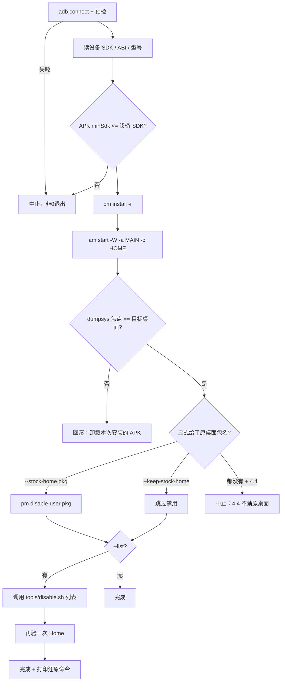

# 技术设计：安装器

## 1. 组成

```
install.sh / install.ps1     编排：预检 → 安装 → 验证 Home →（可选）禁原桌面 → 跑列表
restore.sh / restore.ps1     编排：enable 记录项 → 恢复原桌面 → 验证 →（可选）卸载
tools/                        原样取自 cleanyourtv：disable.sh、restore.sh、tv.py、recovery.py、check.py、requirements.txt
examples/<model>/             debloat.txt（包名，一行一个）+ tv.json（机型信息）
docs/devices/<model>.md       陷阱与实测记录
```

`tools/` 与上游保持同构：升级时 `git diff` 应只看到"我们没改"的空结果；本仓自己的逻辑全部在顶层两个脚本里。

## 2. 流程



关键：`F` 是硬闸门。任何禁用都排在 `F` 之后。

## 3. 状态与记录

复用上游 `recovery.py` 的记录机制（按列表文件路径 + 设备标识存"当时状态"），本仓只额外记录两件事，写在 `~/.aerialclean/state/<device>.json`：

```json
{
  "pkg": "io.github.flyfly6.aerialclean",
  "apk_sha256": "…",
  "installed_at": "2026-10-26T12:00:00Z",
  "stock_home": "com.vendor.launcher/.MainActivity",
  "stock_home_was_disabled": true,
  "list": "examples/<model>/debloat.txt"
}
```

- `install.sh` 结束时写；`restore.sh` 读它决定"是否恢复原桌面""是否卸载"。
- 多次运行：读已有记录，`stock_home` 已存在则沿用，不重复记录。

## 4. 4.4 差异处理

| 步骤 | 4.4 做法 |
|---|---|
| 识别原桌面 | `resolve-activity` 不存在 → 必须由用户 `--stock-home` 指定；不提供则默认不禁用（安全优先） |
| 安装 | `adb install -r` 通用；`pm install` 走 `tv.py` 包装 |
| 启动 | `am start -W -n <pkg>/.HomeActivity`；`-W` 在 4.4 可用 |
| 焦点验证 | `dumpsys window \| grep mCurrentFocus` 通用 |
| 无障碍/通知监听 | 不做；4.4 不需要守护 |
| 权限授予 | 全部跳过（4.4 没有 `pm grant`），输出里说明跳过原因 |

## 5. 平台一致性

- bash 与 PowerShell 各写一份，**命令集合与顺序逐条对齐**；共享的复杂逻辑（JSON 读写、包名校验）放在 `tools/`（Python），两边都调用同一个 Python。
- 差异只在：路径分隔、adb 可执行名、终端配色。
- `--dry-run` 两边都必须支持，输出格式一致（一行一条 adb 命令）。

## 6. 错误与退出码

| 码 | 含义 |
|---|---|
| 0 | 成功（含"已是最新"的幂等重跑） |
| 2 | 用法错误 |
| 3 | 依赖缺失（adb / python / APK 不存在） |
| 4 | 设备不可达 |
| 5 | APK 不兼容（minSdk 高于设备） |
| 6 | Home 验证失败（已回滚） |
| 7 | 禁用阶段失败（部分禁用，已打印还原命令） |

任何非 0 退出都必须在最后一行打印 `restore.sh` 的确切调用，用户不需要翻文档。

## 7. 安全闸门的实现位置

- 包名形状校验、核心包白名单：保持在 `tools/disable.sh`（上游已有），本仓不放宽。
- "Home 必须已切换"：本仓 `install.sh` 增加一次**独立**检查（不依赖上游 Home guard），因为上游 guard 只保证"不会禁到最后一个 Home"，不保证"禁之前新桌面真的能起来"。
- 列表文件必须存在于 `examples/` 或用户显式路径；不接受从网络拉取。

## 8. 测试策略

- 单元：Python 侧对"记录文件读写、包名校验、命令批次生成"写 `pytest`（或 `unittest`），不依赖设备。
- 无设备：`--dry-run` + 假 `adb`（PATH 前置一个打印参数的脚本）验证顺序与参数。
- 有设备：PRD 的 A3–A7 手动执行，输出贴进 `docs/devices/<model>.md`。
- 不 mock `adb` 的真实行为：`pm disable-user` 的接受与否只能由设备回答。

## 9. 回滚形状

- 阶段回滚：安装失败 → 卸载本次安装的包；Home 验证失败 → 卸载 + 不碰原桌面。
- 全局回滚：`restore.sh` 按记录 enable 全部 + 恢复原桌面 + 可选卸载。
- 不做"自动恢复出厂"：那是用户的决定，脚本只提供信息与命令。
