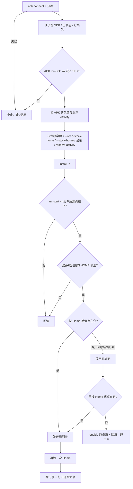

# 技术设计：安装器

## 1. 组成

```
install.sh / install.ps1     启动器：找 python，转参数，exec lib/installer.py install
restore.sh / restore.ps1     启动器：同上，restore
lib/installer.py             全部逻辑：预检、安装、三道 Home 闸门、停用编排、状态记录、还原
tools/                       原样取自 cleanyourtv：disable.sh、restore.sh、tv.py、recovery.py、
                             check.py、requirements.txt（见 tools/UPSTREAM.md）
examples/<model>/            debloat.txt（包名，一行一个）+ tv.json（机型信息与验证状态）
docs/devices/<model>.md      陷阱与实测记录
```

**逻辑只写一份**，放在 `lib/installer.py`：bash 与 PowerShell 各自 15 行启动器，只做参数映射与
找解释器。两个平台的命令顺序因此不是"逐条对齐"出来的，而是同一段代码跑出来的。

`tools/` 与上游保持同构：升级时 `git diff tools/` 应只看到上游自己的改动；本仓的逻辑一行都不进去。

## 2. 流程



闸门 3 为什么后面还允许"先停用再验证"，见 `.trellis/spec/tools/debloat-safety.md` 第 1 条：
Android 13 TV 镜像上 `set-home-activity`、HOME role、清单 priority 全部不生效，让新桌面成为唯一
Home 候选是唯一可靠路径；被停用的只有"原桌面"一个包，且失败在同一进程里立刻 `enable` 回来。

## 3. 状态与记录

停用项的还原依赖上游 `recovery.py` 的记录（按设备 + 列表文件路径存"当时状态"）。本仓只额外记录
自己的决定，写在 `~/.aerialclean/state/<序列号>.json`：

```json
{
  "package": "io.github.flyfly6.aerialclean",
  "home_component": "io.github.flyfly6.aerialclean/io.github.flyfly6.aerialclean.HomeActivity",
  "apk_sha256": "…",
  "installed_at": "2026-10-26T15:12:24+00:00",
  "stock_home": "com.google.android.tvlauncher",
  "stock_home_disabled": true,
  "stock_list": "~/.aerialclean/lists/<序列号>-stock-home.txt",
  "lists": [{"path": "…/stock-home.txt"}, {"path": "…/examples/<model>/debloat.txt"}],
  "launcher_disabled": false
}
```

- `stock_list` 是"只含原桌面一个包"的列表文件，因此停用原桌面也走 `tools/disable.sh`，自带白名单、
  Home guard 与还原记录——本仓不自己拼 `pm disable-user`。
- 重复运行：`stock_home` 已存在就沿用；`lists` 去重；上游记录"第一份为准"，不会写第二份。
- `launcher_disabled` 记录"还原时为了让 Home 回到原桌面，把 Lite 停用了"；下次 `install.sh` 会先
  `pm enable` 它。

## 4. 版本差异

| 步骤 | Android 7 以下 |
|---|---|
| 识别原桌面 | 没有 `cmd package resolve-activity` → 必须 `--stock-home`；只给 `dumpsys activity` 的 `mHomeProcess` 当提示，不自动采用 |
| 确认 HOME 候选 | 没有 `cmd package query-activities` → 跳过这一闸门，靠 aapt2 从清单证明，并打印跳过了什么 |
| 接管方式 | 与新版相同：按 Home 验焦点，不行就停用原桌面（可逆） |
| 权限授予 | 不做（4.4 没有 `pm grant`） |
| 焦点验证 | `dumpsys window \| grep mCurrentFocus` 通用 |

## 5. 平台一致性

- 一份 Python 实现，两个启动器；差异只剩解释器名（`python3` / `python` / `py -3`）与路径分隔。
- `--dry-run` 在两个平台输出同一批命令（一行一条 `adb …` / `TV_HOST=… bash tools/disable.sh …`）。
- PowerShell 参数：`-TvHost`、`-Apk`、`-List`、`-NoDebloat`、`-KeepStockHome`、`-StockHome`、
  `-DryRun`、`-Help`；还原侧 `-TvHost`、`-Uninstall`、`-DryRun`、`-Help`。

## 6. 错误与退出码

| 码 | 含义 |
|---|---|
| 0 | 成功（含"已是最新"的幂等重跑） |
| 2 | 用法错误（未知参数、`--stock-home` 指到没装的包） |
| 3 | 依赖缺失（adb / aapt2 / APK / tools/venv / 列表文件） |
| 4 | 设备不可达（连不上、多台设备、读不到 SDK） |
| 5 | APK 装不上或不兼容（minSdk 高于设备、ABI 不匹配） |
| 6 | Home 验证失败（已回滚：卸载本次安装的 APK、启用回原桌面） |
| 7 | 停用阶段失败（可能部分生效，已打印还原命令） |

任何非 0 退出都在最后一行打印 `./restore.sh` 的确切调用。

## 7. 安全闸门的实现位置

- 包名形状校验、核心包白名单、Home guard、还原记录：都在 `tools/disable.sh` / `recovery.py`，
  本仓不放宽、不绕过。
- 三道 Home 闸门在 `lib/installer.py`：① 新桌面自己起得来；② 它是系统列的 HOME 候选；
  ③ 按 Home 就落到它（这一条失败才允许停用原桌面）。上游 guard 只保证"不会禁到最后一个 Home"，
  不保证"新桌面真的接管了"。
- 列表文件必须存在且每行是包名；不接受网络来源。

## 8. 测试策略

- 静态：`bash -n`、`py_compile`、`pwsh` 解析 `*.ps1`。
- 无设备：`ADB=/usr/bin/true`（无设备）、`ADB=/nonexistent`（缺依赖）、`--apk` 不存在、未知参数，
  逐个确认退出码。
- 有设备（AVD `aerial_tv_api33`）：`--dry-run` 批次 + 真实安装/接管/停用/还原/卸载，逐条对照
  `pm list packages -d` 与 `dumpsys window | grep mCurrentFocus`；记录进
  `docs/devices/google-atv-emulator.md`。
- 不 mock `adb` 的行为：`pm disable-user` 接受与否、Home 落到谁，只能由设备回答。

## 9. 回滚形状

- 阶段回滚（同一次运行内）：新桌面起不来 / 不是 HOME 候选 / 停用原桌面后 Home 仍不对 → 卸载本次
  安装的包 + `pm enable` 原桌面。
- 全局回滚：`restore.sh` 按记录 `enable` 全部 + 恢复原桌面；若新桌面还占着 Home，就停用它（可逆），
  必要时 `--uninstall` 卸载。
- 不做"自动恢复出厂"。
