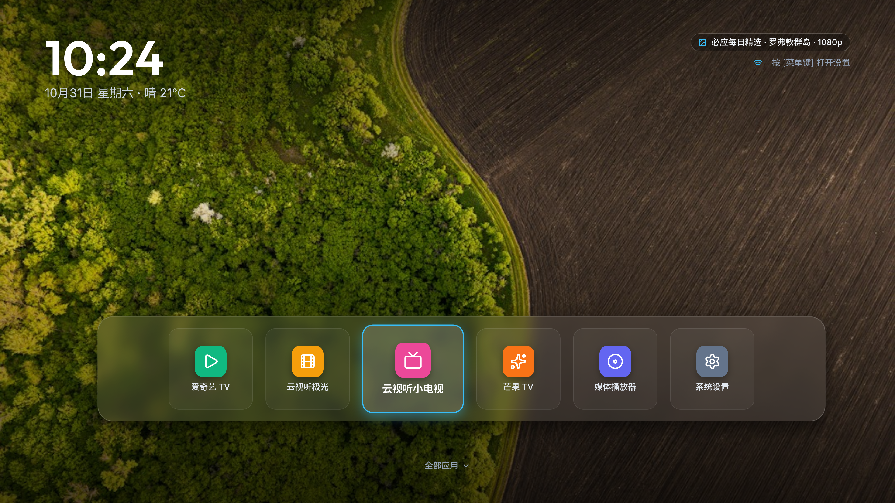
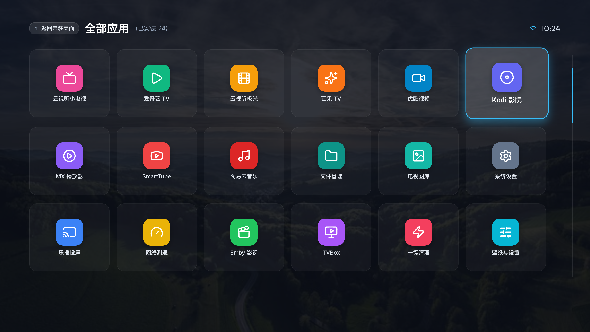
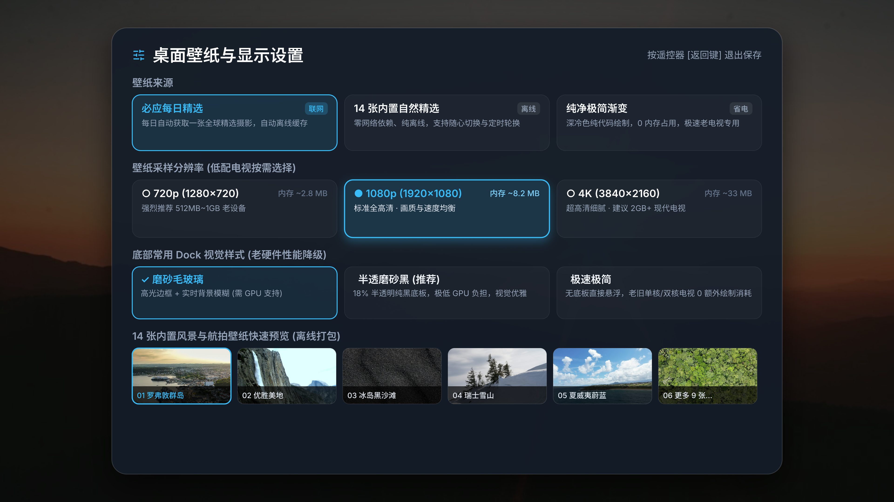
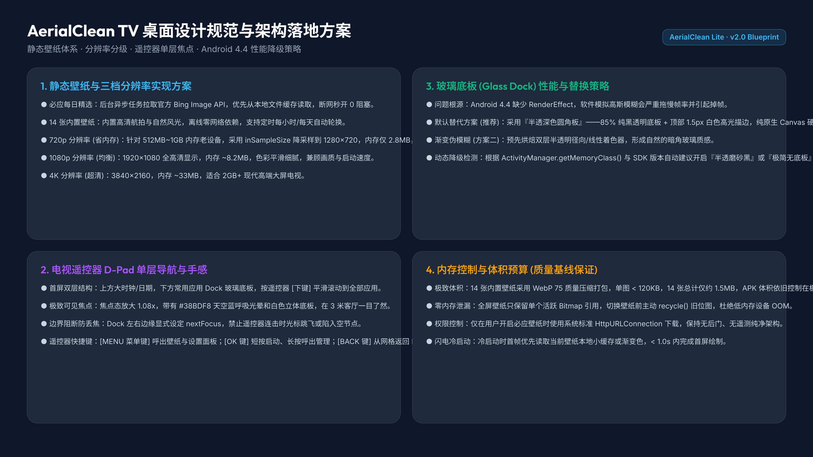
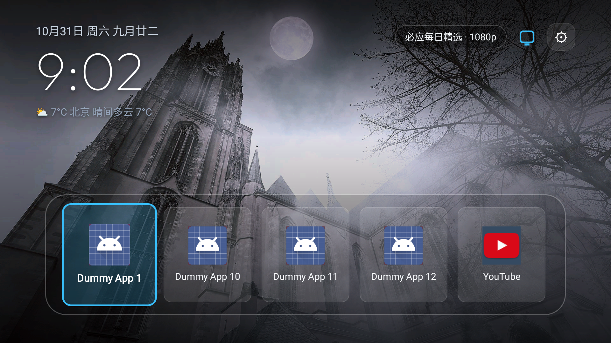
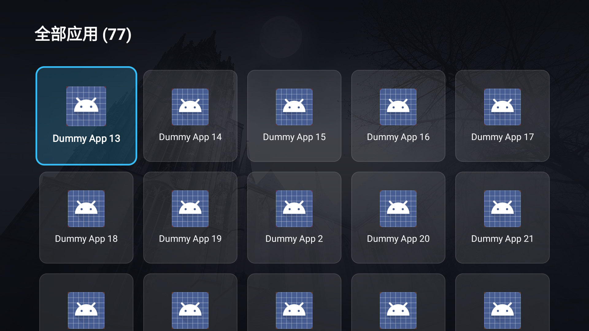
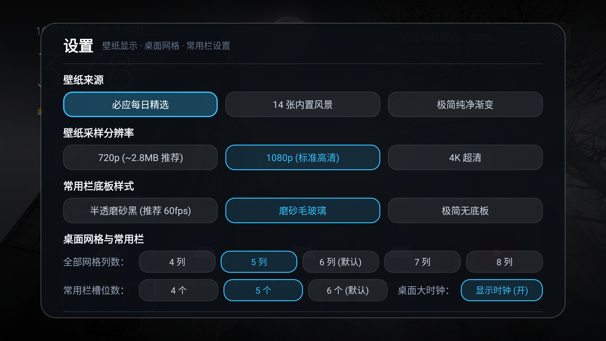
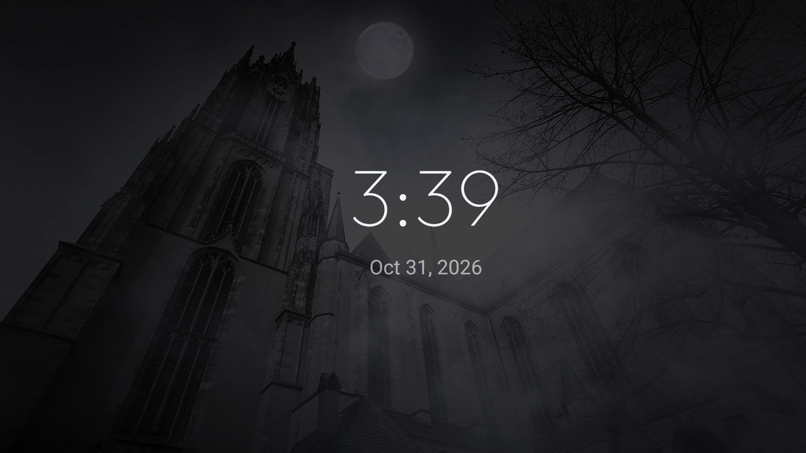

# AerialClean TV 桌面设计预览与说明

本文档与设计源文件保存在 Trellis 任务目录：
- 设计源文件：[`design.pen`](./design.pen)
- 高清预览图目录：[`preview/`](./preview/)

---

## 1. 桌面首屏（静态壁纸 + 三行信息时钟 + 悬浮玻璃 Dock）

- **顶栏状态**：
  - **左上角三行信息排版（对齐 aerial-tv 经典设计）**：
    - 第一行：`公历日期 + 星期几 + 农历月日`（例如：`10月31日 周六 九月廿二`），内建 1900-2050 纯算法阴历引擎；
    - 第二行：`现代无衬线大时钟`，采用 Google Fonts 开源现代几何字体 Outfit；
    - 第三行：`天气矢量图标 + 实时温度 + 城市位置 + 天气状况 + 当天温标`（例如：`⛅ 6°C 北京 晴间多云 6°C`），对接 Open-Meteo 免 key API 自动定位并离线缓存；
  - **右上角快捷操作与网络状态**：
    - `必应每日精选 · 1080p` 沉浸半透壁纸标签；
    - `纯矢量 WiFi / 有线网络状态图标`（自绘天蓝双弧扇形波纹 / RJ45 以太网图标）；
    - `设置齿轮按钮`（44×44dp 半透圆角卡片，`⚙` 矢量质感，支持遥控器上键导航获焦点击或按菜单键呼出）；
- **底部常用 Dock**：
  - 左右预留 64dp 安全外边距，水平自适应居中；
  - **上下内边距严格对称（20dp Top / 20dp Bottom）**：移除磁贴多余上下外边距，容器高度自适应包裹，彻底根除上下间距不一致问题；
  - 磁贴外框圆角调整为精致硬朗的 12dp，内图标盒为 10dp；
  - 磁贴内图标与应用文字垂直完美居中，获焦时 1.08x 放大对称展开并带有天蓝色呼吸光晕边框；
  - 移除多余的“全部应用 ▾”辅助文案，保持电视大屏极简纯净。

---

## 2. 全部应用网格视图（流转展开状态）

- **85% 深色沉浸暗角遮罩**：向下进入全部应用时背景自动叠加深色遮罩，保证大量应用磁贴与文字的高对比度清晰度；
- **纯净顶栏**：移除多余的“按 [返回键] 或 [方向上键] 返回首页”提示文字，仅保留纯净醒目大标题 `全部应用 (N)`；
- **自适应网格排列**：整齐排列全部已安装应用，当前遥控器焦点项突出放大；在第一行按【方向上键】或按【返回键】随时平滑回到首屏 Dock。

---

## 3. 桌面壁纸与显示设置面板（按设置按钮或菜单键呼出）

- **壁纸来源选择**：
  1. `必应每日精选`（支持后台获取与离线缓存）；
  2. `14 张内置自然风景`（纯离线 0 网络依赖，支持定时轮换）；
  3. `纯净极简纯黑`（纯代码绘制，0 内存占用）。
- **壁纸采样分辨率分级（核心性能保障）**：
  - `720p (1280×720)`：内存仅 **~2.8MB**，强烈推荐 512MB~1GB 老电视（彻底规避系统杀后台）；
  - `1080p (1920×1080)`：内存约 **~8.2MB**，画质与性能均衡，标准全高清；
  - `4K (3840×2160)`：内存约 **~33MB**，超清细腻，建议 2GB+ 内存的现代电视开启。
- **内置风景壁纸快速切换**：
  - 14 张内置自然风光左右方向键快速预览与即时切换。
- **常用栏底板样式**：
  - `半透磨砂黑 (推荐)`（85% 半透明纯黑底板 + 1.5px 白色高光描边，0 GPU 模糊开销，老电视稳跑 60fps）；
  - `磨砂毛玻璃`（现代设备）；
  - `无边框极简`（无底板直接悬浮）。
- **桌面网格与常用栏个性化**：
  - `全部网格列数`：支持 4列 / 5列 / 6列(默认) / 7列 / 8列；
  - `常用栏槽位数`：支持 4个 / 5个 / 6个(默认)，槽位不足或有隐藏应用时自动从应用列表中按序精准补齐；
  - `桌面大时钟`：支持显示时钟开启 / 关闭；
- **系统原生设置入口**：一键直达 Android TV 原生设置页。

---

## 4. 架构规范与 Android 4.4 落地保证

- **体积控制**：14 张内置壁纸采用 WebP 75 压缩打包入 APK（单张约 100KB，总增加约 1.5MB，APK 体积依旧小巧）；
- **内存安全**：解码采用 `BitmapFactory.Options` 配合 `RGB_565` 格式与 `inSampleSize`，切换壁纸主动 `recycle()`；
- **遥控按键逻辑**：`DOWN` 展开网格，`UP` 收起回 Dock，`MENU` 或点击齿轮呼出设置，`BACK` 网格回 Dock。

---

## 5. 实际设备运行效果（AVD aerial_tv_api33 1080p 验证）

### 首屏桌面实机渲染（像素级还原）

- **左上角**：纯正 Outfit 现代无衬线大时钟，三行经典排版（公历+农历九月廿二、大时钟、北京天气 6°C ⛅），纯白文字配合柔和投影；
- **右上角**：壁纸标签（`必应每日精选 · 1080p`）、自绘矢量网络图标、设置齿轮图标；
- **底部 Dock**：左右 64dp 安全边距，水平自适应居中，上下对称各留 20dp 呼吸边距（获焦时 14dp 严格对称）；5 槽位精准展示 5 个应用，磁贴 12dp/10dp 精致小圆角，移除“全部应用 ▾”多余文案。

### 全部应用网格实机视图（视图流转）

- 移除右上角提示文案，保持纯净；
- 首屏按遥控器【方向下键】平滑展开网格层并自动叠加上层深色暗角；在网格第一行按【方向上键】或按【返回键】平滑退回首屏 Dock。

### 现代化卡片设置面板（全功能收录）

- 像素级还原暗黑卡片风格，收录壁纸来源、分辨率采样、14张内置风景切换、底板样式、列数、槽位数、时钟开关与系统设置入口；
- 全 D-Pad 遥控交互与即时响应。

### 时钟防烧屏屏保（壁纸背景实机效果）

- 空闲 60s 自动唤醒 `ClockSaver`；
- 原生 Canvas center-crop 绘制当前壁纸，叠加 75% 沉浸深色防烧屏遮罩；
- Outfit 字体纯白大时钟与日期随机漂移，按任意按键退出屏保。
